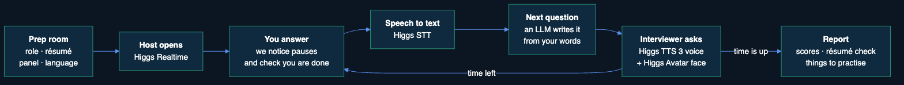

# HotSeat: project overview

HotSeat is a practice interview with an AI panel. A moderator runs the call, and a Technical Lead and a Mentor take turns asking follow-up questions about one project the candidate built, by voice and on camera, until the chosen time is up. Then the candidate gets a scored report.

Built for the Boson AI × MScAC Higgs Audio Hackathon 2026.

## Why

In a technical interview, the hard part is the follow-up questions about your own project: why you built it this way, what happens when it breaks, how you know it works. Practising alone, nobody asks them, and practice with real interviewers is hard to get.

## How it works

1. **Prep room**: the candidate picks the role, language (8), interview length (2–15 minutes), a voice for each seat (100+ voices), and can add a résumé.
2. **Moderator opens** on Higgs Realtime and asks for a project introduction.
3. **The candidate answers.** The browser notices pauses (Silero VAD) and an LLM checks whether the answer is finished.
4. **Speech to text**: Higgs STT.
5. **Next question**: an LLM writes it from the candidate's own words, at the difficulty chosen for that interviewer.
6. **An interviewer asks it** with a Higgs TTS 3 voice and a Higgs Avatar face. Steps 3–6 repeat until time is up.
7. **Report**: five skill scores with quotes, a résumé check and practice drills.

## Design ideas

- **One panel, three Higgs models.** Higgs Realtime is the moderator because it has to answer at once; Higgs TTS 3 gives each interviewer its own voice and tone; Higgs Avatar gives them a face (20 voices have a photo).
- **No awkward silence.** The next question is written, and its video rendered, while the candidate is still answering the current one. After the introduction the moderator asks a short background question to buy time for the first video. The panel never cuts in on a pause: an LLM checks that the answer is really finished.
- **Built on what the candidate said.** There is no question bank, and a question that repeats an earlier one is caught and rewritten. The report quotes the candidate's own words and checks every quote against the transcript.

## Where each part runs

| Part | Runs on | What it does |
|---|---|---|
| Browser (React, Vite) | the candidate's computer | Prep room, meeting screen, interview flow, pause detection, report page |
| Higgs Realtime | Boson AI, WebSocket from the browser | The moderator |
| Server (Node.js, Express) | local | Keeps API keys, calls the models, stores interviews in PostgreSQL |
| Higgs TTS 3, Higgs Avatar | Boson AI | Interviewers' voices and talking faces |
| Higgs STT, with whisper.cpp | Boson AI; whisper.cpp local | Answer transcripts |
| LLM (DeepSeek; OpenAI, Claude, Gemini as backups) | API | Writes questions, checks whether an answer is finished, writes the report |
| PostgreSQL | local | Interviews, transcripts, reports |

## Code map

| Folder | Contents |
|---|---|
| `src/` | Browser app: `interview.ts` (interview flow), `ui/` (screens), `realtime/` (moderator), `audio/` (mic, pause detection, player), `avatar/` (video) |
| `server/` | Express routes, Boson calls (`boson.ts`), question writing (`questions.ts`), report (`report.ts`), LLM providers (`llm.ts`) |
| `shared/` | Types and settings used by both sides: seats, languages, the registered voices |
| `corpus/` | Every fixed line and prompt, one pack per interview language |
| `scripts/` | Pre-rendering the interviewers' videos, building a report offline |

Setup and usage are in the [README](../README.md).
